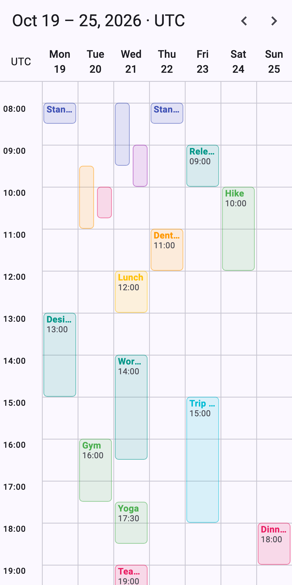
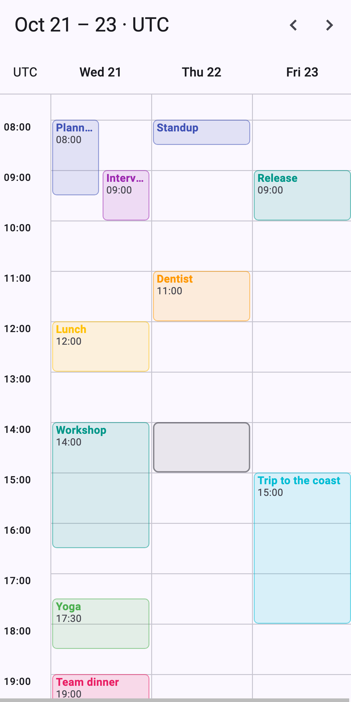
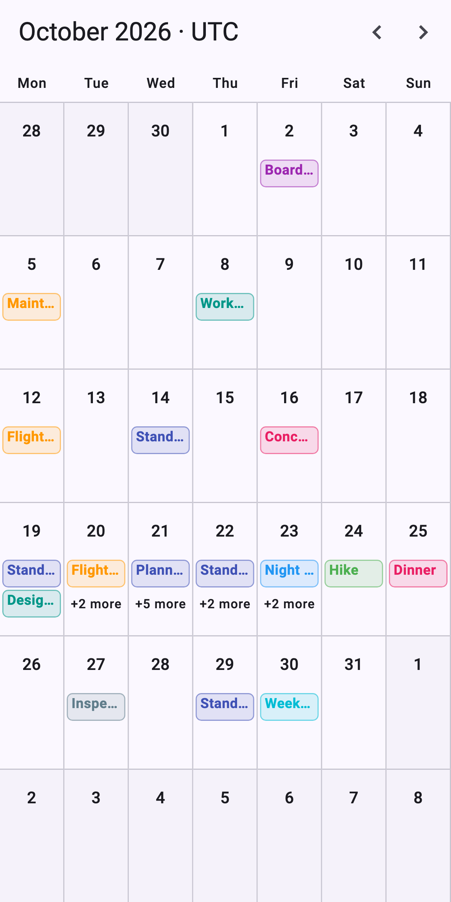
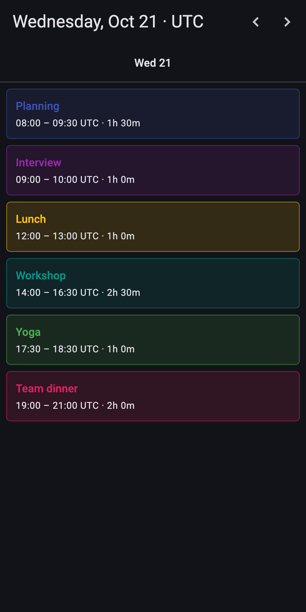

# utc_calendar

A Flutter calendar grid for events kept in UTC, such as logs, bookings or
schedules shared across time zones. Everything is laid out by UTC day and
time, whatever the device's time zone.

- **Views:** month, week (fitted to the width), three days, a single day, and a
  daily schedule list.
- **Layout:** overlapping events side by side; events crossing midnight
  continue on the next day.
- **Interaction:** taps on events, days and empty time; long-press and drag to
  move events; pinch zoom of the hourly views, with accessible zoom controls.
- **Paging:** swipe or arrows between periods, with a helper for the next date
  and support for animated transitions.
- **Your look:** you decide event colors, indicators, tooltips and schedule
  rows.

<p>
   
</p>

The package draws the grid. Your app owns the header, the date state,
navigation buttons, loading events and what happens on a tap.

## Getting started

```yaml
dependencies:
  utc_calendar: ^1.0.0
```

```dart
import 'package:utc_calendar/utc_calendar.dart';

final events = [
  CalendarEvent(
    id: 'event-1',
    title: 'Project planning',
    start: DateTime.utc(2026, 10, 22, 9),
    end: DateTime.utc(2026, 10, 22, 10, 30),
  ),
];

CalendarGrid<CalendarEvent>(
  focusedDay: DateTime.utc(2026, 10, 22),
  view: CalendarViewType.fitWeek,
  monday: true,
  items: events,
  hourHeight: 64,
  onHourHeightChanged: (height) {},
  eventColorBuilder: (context, event) => Theme.of(context).colorScheme.primary,
  onDayTap: (day) {},
  onEmptyTimeTap: (utcTime) {
    // Open your event editor with utcTime as the start time.
  },
  onEventTap: (event) {},
  onEventLongPress: (event) {},
  onPreviousPeriod: () {},
  onNextPeriod: () {},
)
```

See [`example/`](example) for a complete app that keeps the navigation state
and uses the grid. To run it, create its platform folders first:
`cd example && flutter create . && flutter run`.

## Views

`CalendarViewType.fitWeek` shows the UTC week with all seven columns fitted to
the available width, without horizontal scrolling. Three-day and day views keep
a minimum column width and scroll horizontally when they don't fit. All hourly
views support zoom, event actions and empty-time taps.

`CalendarViewType.schedule` lists the focused UTC day's events, sorted by start
time and then id. Overnight events that occur that day are included. Rows show
the full title and time label and use your color, leading, tooltip, tap and
long-press builders. The list always scrolls, even when empty, so it can be
wrapped in a `RefreshIndicator`. It has no hourly grid, zoom or empty-time
taps, and navigation moves one day at a time. Use `scheduleItemBuilder` to
replace its rows with your own; your rows then handle their own taps.

`CalendarViewType.isHourly` tells the timeline views from month and schedule.

## Navigation

Three-day views show the focused UTC day and the two following. Call
`calendarPageDate(focusedDay, view, monday, direction)` (`direction` -1 or 1)
in your navigation callbacks: it moves three-day and day views by a day,
week views by a week and month views by a month. `calendarDayCount` is the
number of days shown, not the navigation step.

### Animated transitions

To animate hourly transitions, update `CalendarGrid.periodOffset`: it moves
only the day headings and event columns, while the UTC and hour labels stay in
place. An overlaid preview can set `showTimeColumn: false` to avoid duplicate
labels. For three-day windows moving by `n` days (1 to 3), set the preview's
`previewDayIndex` to `3 - n` when moving forward or 0 when going back, and
`previewDayCount` to `n`, and offset it by `n` column widths. Only the entering
days are painted, so shared events aren't drawn twice.

Once a period drag starts, it stays horizontal until it ends: vertical drift
neither scrolls the timeline nor resets the offset, and a second finger cancels
paging for pinch zoom. On narrow grids the lock starts while the columns are
scrolled, before reaching a paging edge. `onPeriodDragEnd(cancelled, velocity)`
reports the release velocity in pixels per second (zero when cancelled), for
example to add a short glide before snapping to a day.

## Interaction

`onEmptyTimeTap` reports the UTC date and time of a tap in empty space in the
hourly views, truncated to the minute with no snapping. Taps on events,
headings or the time column, scrolling and multi-touch don't call it. Month
view calls `onDayTap` instead, and schedule doesn't report empty-time taps.

Pass a UTC `draft` range to outline a provisional slot in the hourly views,
for example around an empty-time tap while asking what to add there. It's a
soft grey block under the events, split across days when it crosses midnight,
and it never takes taps. Set it to `null` to hide it.

Set `highlightedEventId` to an event's `id` to draw attention to it, for
example after returning from its page: the tile brightens in its color and
fades back, in every view. To highlight the same event again, clear the id
first.

### Moving events

Pass `onEventMoved` to let users move events. Long-press a tile and drag it.
In the hourly views it follows the finger in `moveStep` steps (15 minutes by
default) and across days, with a label showing where it will land; it scrolls
near the top and bottom and pages to the previous or next period when held
against the left or right edge. In month view, drop it on another day; it keeps
its time. On release, `onEventMoved(event, newStart)` reports the new start if
it changed, and your app moves the event. Return false from `canMoveEvent` to
keep an event in place; long-pressing it then calls `onEventLongPress`, for
example to explain why. Moving disables the tile's long-press tooltip.

With `showHiddenEventHints`, an event scrolled out of sight above or below
shades the top or bottom edge of its day column in its color, so users know to
scroll. It's off by default.

## Events

`CalendarGrid` takes `CalendarEvent` or any subclass of it, so your events can
carry their own data. `DateTime` values are normalized to UTC. Events without a
start are skipped. A missing or invalid end gives a 30-minute slot, without a
duration in the label. Events crossing UTC midnight continue on the next day.

An event's optional `displayDuration` gives it a fixed size without changing
its recorded times or label. It also decides which days it appears on and how
it overlaps others, skips the minimum tile height, and is clipped at UTC
midnight. Small tiles clip their contents; tooltips keep the full title and
times.

The package doesn't decide colors or categories: `eventColorBuilder` is
required, `eventLeadingBuilder` adds indicators, and `eventTooltipBuilder`
adds details to the default tooltip (title and time).

## License

MIT; see [LICENSE](LICENSE).
